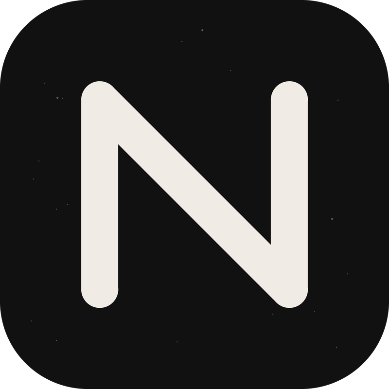

  

<h1 align="center">Meshchat neXt</h1>

Mesh messaging, tactical mapping and extension calling—together, with clear network boundaries.

Meshchat neXt brings **Reticulum**, **MeshCore**, **tactical mapping** and **SIP calling** into one app. Start with the services you need, connect your devices, and keep conversations organized without losing track of which network you are using.

Use it over compatible LoRa radios, local networks or internet connections, depending on the service. Reticulum/RNode and MeshCore can run simultaneously through their own independent connections.

**New here?** Start with the [field guide](docs/guide/README.md). It explains the networks, device setup, everyday use and common questions without assuming prior experience.

## Choose how you communicate

| Service            | What it does                                                                                                   | What you need                                                 |
| ------------------ | -------------------------------------------------------------------------------------------------------------- | ------------------------------------------------------------- |
| **Reticulum**      | LXMF messaging, announces, contacts and LXST voice calls over supported interfaces                             | A suitable network connection; an RNode is optional           |
| **MeshCore**       | LoRa direct messages, hashtag/private channels, discovery and supported repeater, room-server and sensor tools | A compatible MeshCore companion connected by Bluetooth or USB |
| **Tactical tools** | Map positions, pins, reports, drawings, routes, team alerts and supported TAK data exchange                    | Maps and optional MeshCore team or TAK-server configuration   |
| **SIP**            | Internet extension calling, including an editable Hams Over IP server preset                                   | Your own provider account, extension and password             |

**One interface does not mean one network.** Reticulum, MeshCore and SIP retain separate identities, addresses and connections. Messages are not automatically bridged between them. Contacts are linked across services only when you explicitly choose to link them.

## Highlights

### Messaging and contacts

- Reticulum and MeshCore conversations in the same Messages area, with clear network labels.
- Shared contact management with separate addresses and explicit cross-network linking.
- Separate Reticulum and MeshCore announce lists.
- MeshCore channels with unread indicators, ordering, hide/show, deletion and replies.
- All-message, mentions-only and muted channel notifications, plus local message blocking.
- DM acknowledgments, heard-repeat counts and captured-path details where available.
- Map captured paths or reported client locations when usable location information exists.

### Radios and mesh tools

- Independent RNode and MeshCore connections.
- MeshCore Bluetooth/USB selection and connection controls.
- Frequency, bandwidth, spreading factor, coding rate, transmit power and supported 1–3 byte path hashes.
- Local/flood adverts, node discovery, trace tools, RX logs, noise information and supported region discovery/channel scoping.
- Supported node login, status and administration, with optional secure credential saving on Android.

### Photos, voice and tactical mapping

- Optional MediaMesh/Radio2 photos and recorded voice clips in MeshCore DMs and channels.
- Preview before sending, explicit downloads/retries and cached viewing/playback.
- Offline maps with supported tile storage/import, plus tactical positions, reports, drawings and routes.
- Optional team alerts, geofence monitoring and time-limited background position sharing.
- Supported TAK package import/export and optional TAK-server connections.

Radio2 media requires compatible firmware and client support at both ends. **Standard MeshCore text does not require Radio2.** Radio2 uses a second profile on the same transceiver; it does not provide live MeshCore telephone calls.

## Get started

1. Download the Android APK from the [Meshchat neXt Releases page](https://github.com/hk1200/Meshchat-neXt/releases) and install it.
2. Choose the services you want during first-start setup. You can revisit these choices under **Settings → App features**.
3. Keep your existing setup or import a supported identity/backup. Review the proposed changes before applying them.
4. Connect your RNode and/or MeshCore companion, or configure the network interfaces you need. Reticulum TCP setup offers **rmap.world** and adds its connection when requested.
5. For SIP, enter your own account details under **Settings → SIP**. The HOIP server preset is editable; no personal account is supplied.
6. Send a short test message or make an extension call to a known reachable contact.

Existing radio settings take priority over setup defaults. Use firmware for your exact board, radio module and Bluetooth/USB connection. Setup explains the optional Radio2 firmware requirements and links to the relevant releases.

### Bringing an existing setup?

Supported imports include Reticulum identity exports, recognized MeshCore companion JSON configurations, supported multi-device archives and encrypted neXt identity backups. The preview identifies supported fields and possible changes.

Import support varies by format. A backup cannot create Android Bluetooth pairing bonds, and an identity import does not automatically restore another app’s complete message database.

## Learn more

- [Complete field guide and FAQ](docs/guide/README.md)
- [Interactive field guide](docs/guide/index.html)—download/open the HTML edition for search and checklists; GitHub renders the Markdown edition above.
- [Android build instructions](android/README.md)
- [Developer handbook](docs/en/getting-started.md)

## Compatibility and important limits

neXt uses each service’s supported protocols. Reticulum messaging depends on LXMF compatibility, and Reticulum calling requires LXST support. MeshCore text, Radio2 media and tactical messages each have their own firmware/client requirements. Supported neXt/Open TAK media and tactical exchanges have been tested; this does not imply support for every TAK datatype or deployment.

- **MediaMesh photo/audio payloads are unencrypted over radio**, even when the announcing DM is encrypted. Do not assume an encrypted DM protects its media transfer.
- Public hashtag channels are not private. Region scoping controls forwarding, not access or encryption.
- Heard repeats are observed matching packets, not a unique-repeater count or proof of delivery. Short path hashes can match more than one node.
- Offline maps require the relevant tiles to be stored on the device. Wi-Fi access alone does not make every map area available offline.
- SIP availability and audio depend on the provider and network. HOIP calls extensions rather than ordinary telephone numbers; its UDP preset does not promise end-to-end encrypted calling.
- Firmware determines available radio/node controls. USB reattachment can require refreshing and selecting the device again.

## Community and support

Join **Meshchat neXt Relay** over Reticulum:

**Destination:** `ef933cd2c155bbef703fdf59100598a8`

| Room                             | Use it for                         |
| -------------------------------- | ---------------------------------- |
| `bug reports`                    | Problems and reproducible failures |
| `feature requests & suggestions` | Ideas and improvements             |
| `general`                        | Questions and community discussion |

In the app, open **About → Contact / Support**. You can also use the [Meshchat neXt issue tracker](https://github.com/hk1200/Meshchat-neXt/issues) for bugs and feature requests.

Include the app version, device/platform and steps to reproduce a problem. Remove passwords, private keys and other sensitive information before sharing diagnostics. Opening a relay room does not automatically submit a report.

## Open source and acknowledgments

Meshchat neXt brings together work from several open-source communities. Original authorship, copyright notices and dependency licenses are retained.

See [LICENSE](LICENSE), [licensing and acknowledgments](LEGAL.md), and the application’s third-party notices. The neXt N mark is available as an editable [SVG](logo/logo.svg).

### Verified updates

The official Android release checks for signed updates after launch and periodically while the app is open. An available update links to Settings → Reticulum → Updates. Downloads are checked against a signed manifest and checksum; Android requires your approval to install. Update checks respect Privacy Mode and never install silently. Keep the same app installed to preserve its data; do not uninstall before upgrading.
